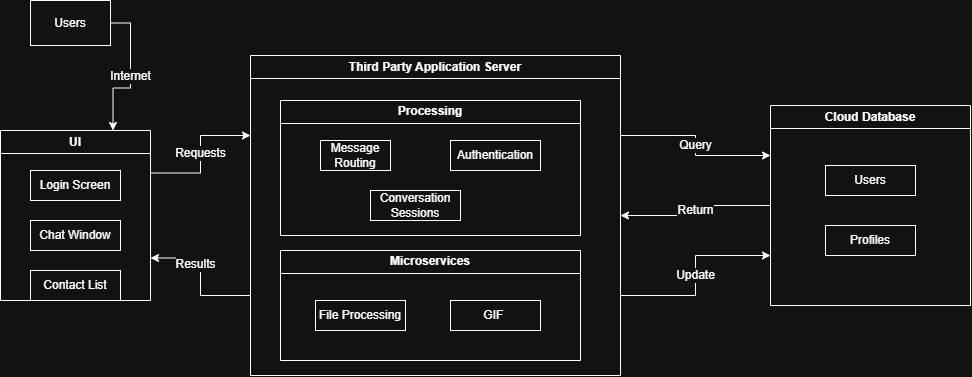

# Talkitive-Pigeon
A desktop messaging app where users sign in, see their conversations, and chat in real time. Built for CSC131 – Software Engineering (Fall 2026).


## Project summary

Talkative-Pigeon is a messenger for people who want a simple, fast way to talk with their team from their computer. Users sign in, pick a conversation from a list on the left, and read and send messages in a chat window on the right. Later iterations will add real user accounts, messages shared between users through a cloud server, and extras such as file sharing and GIFs.

## Development tools

| Purpose | Tool |
|---------|------|
| Language | Java |
| UI framework | JavaFX 21 (styled with CSS) |
| Build tool | Maven |
| Editor | Visual Studio Code (with Live Share for pair programming) |
| Version control | Git and GitHub |
| Hosting (planned) | TODO: the free cloud tier the team picks |
| Database (planned) | TODO: the cloud database the team picks |
## How to run

**You need:** a JDK (the version set by `maven.compiler.release` in `pom.xml`) and Maven. Maven must be installed and added to your PATH.

1. Clone the repository:

   ```
   git clone https://github.com/IvanCortesA/Talkative-Pigeon.git
   cd Talkative-Pigeon
   ```

2. Start the app:

   ```
   mvn javafx:run
   ```

You can also run `Launcher.java` from VS Code or your preferred IDE.

## Architecture Diagram

